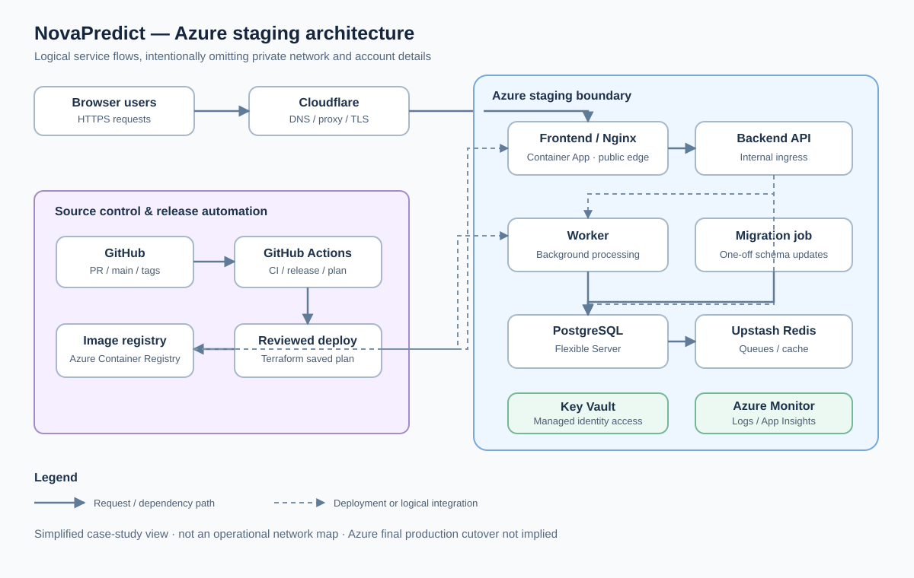

# Architecture

NovaPredict has a frontend, backend API, background worker and separate one-shot database migration job. The diagrams show **logical integration**, not deployable network configuration.

## How requests and jobs flow

- A user's HTTPS request passes through **Cloudflare** to the **frontend/Nginx Container App**. Frontend requests reach the **internal backend API**; the backend is not exposed as a separate public API.
- The backend uses **Azure Database for PostgreSQL Flexible Server** and **Upstash Redis**. The worker processes asynchronous jobs using the same supporting services. A dedicated migration job applies schema changes ahead of a release.
- Container images are built and published to **Azure Container Registry**, then deployed by controlled release workflows.
- **Managed identities** limit access to Azure services such as Key Vault. **Log Analytics and Application Insights** provide operational visibility.

## Why I separated these components

I kept migrations out of API startup to control when schema changes occur. I kept backend traffic internal and avoided public worker access to reduce the external attack surface. I used managed services so the project could focus on application operations without administering every database host.

## What “production” means here

I first proved the complete application locally with Docker Compose. I then built and tested the Azure **staging** platform in Belgium Central. The live public application has a separate deployment history. **The final Azure production environment/cutover is not represented as complete here.**

For security, the image omits IP ranges, private network routing, resource names, account IDs, credentials and operational endpoints.
