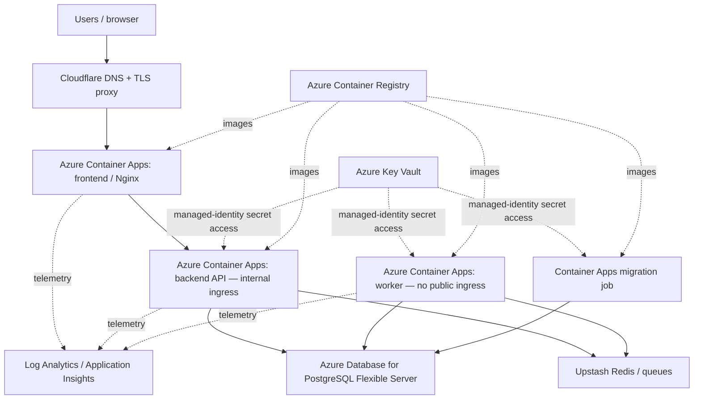

# Architecture

NovaPredict has four application workloads: **frontend**, **backend API**, **background worker**, and a **one-off migration job**. A PostgreSQL database stores application data; Redis supports background processing. I designed and tested the Azure staging platform before promoting the deployment model toward production.

## Why these boundaries matter

- **Only the frontend needs public ingress.** The backend is called through the approved frontend route; the worker has no public HTTP endpoint.
- **The migration job is separate from the API.** Database schema changes run as an explicit release step, not on every web-process startup.
- **Workloads use managed identities and scoped permissions** for Azure services instead of sharing an administrator credential.
- **Cloudflare provides the public DNS/TLS edge.** Staging validation checked both successful public HTTPS and rejection of direct-origin bypass.

The diagram intentionally shows **logical application flows**, not exact subnets, resource IDs, IP addresses or a complete network/security topology. Those details are excluded from the public portfolio.

## Environment distinction

Local Docker Compose was used for production-style functional simulation. Azure staging was provisioned and tested separately. The public application has had a distinct deployment path; the complete final Azure production cutover is **not claimed here**.
