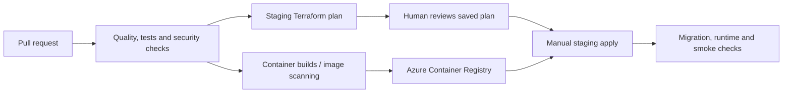

# CI/CD and releases

I use GitHub Actions to separate **checking a change**, **building a release**, and **authorising an infrastructure deployment**.

## High-level flow

## Controls I implemented

1. **CI checks** test the application and run security checks before a release is treated as ready.
2. **Images are published to ACR** and release configuration uses immutable image identifiers rather than relying on a moving `latest` tag.
3. **Staging plan** starts only after a successful main-branch CI run, checks out the exact tested commit, generates Terraform output and rejects destructive/unexpected changes.
4. **Staging apply** is a separate human-triggered workflow. It applies the **saved, reviewed plan**, not a newly calculated plan; database migration runs before application revisions are changed.
5. **Drift detection** runs separately from code pushes, because changes made directly in Azure might otherwise go unnoticed.

## Blue-green rehearsal

The staging project also has independently triggered **deploy-candidate**, **promote** and **rollback** actions. A candidate revision starts at **0% traffic**, is verified, then can receive traffic. A rollback returns traffic to a previous healthy revision without rebuilding the image. This was exercised for backend, frontend and worker in the staging programme.

**Important distinction:** This is evidence of a staging release/rollback workflow. It is not a promise of zero downtime in every production scenario, and schema migrations need separate compatibility planning.
